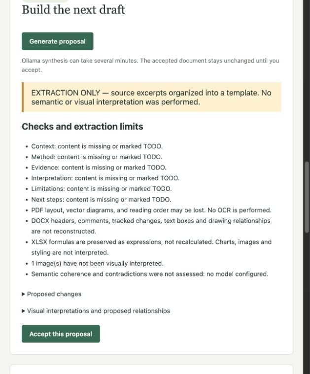

# Document Formatter

A local-first formatting engine for collections of evidence. Import files, choose a standard template, inspect a proposed draft, and accept a revision. Add material later while preserving the accepted document and its edit history.

**Version 0.1 is a feedback prototype.** It is a standalone public project, not connected to any private company journal. All committed examples are synthetic.

## Two explicit operating modes

| Mode | What it does | What it does not do |
| --- | --- | --- |
| Extraction only (default) | Extract source text, organize excerpts in a template, preserve references, flag structural gaps and matching-label numerical discrepancies | No semantic synthesis, image understanding, or general contradiction detection |
| Local Ollama | Propose coherent writing, describe images with a vision model, suggest source relationships, and review logical gaps | No proof of truth, automatic publication, or reliable scientific certification |

**No model is bundled or downloaded.** The first demonstration and CI tests run without a model. Ollama integration is contract-tested with mocks; real-model quality has not been evaluated in this release.

## Quick start

Requires Python 3.11 or newer. From a repository checkout:

```bash
python3 -m venv .venv
source .venv/bin/activate
python -m pip install -e '.[dev]'
python examples/create_inputs.py
docformat serve
```

On Windows, activate with `.venv\Scripts\activate` instead. Open **http://127.0.0.1:4173**. Create a collection, load the synthetic example files, generate a proposal, inspect the checks and diff, then accept. You can edit each accepted section and download Markdown.

Leave the model fields blank to try the extraction-only demonstration. The local server is a single-user development tool, not an internet-facing deployment.

## Input and output support

| Input | Extraction | Limits |
| --- | --- | --- |
| UTF-8 `.txt`, `.md` | Paragraphs with source IDs | Markdown layout is not semantically interpreted in offline mode |
| `.pdf` | Page text and supported embedded raster images | No OCR, vector diagram reconstruction, or layout fidelity; scans are flagged |
| `.docx` | Paragraphs and tables in document order, supported embedded raster images | No legacy `.doc`, tracked-change resolution, text boxes, headers, or image anchoring |
| `.xlsx` | Cell rows and formula expressions | No legacy `.xls`, formula evaluation, charts, images, or styling |
| `.csv`, `.tsv` | Rows and cell values | UTF-8 input; no type inference or formula evaluation |
| `.png`, `.jpg`, `.jpeg`, `.webp` | Image dimensions; normalized local image copy | Meaningful descriptions require a configured vision model |

Outputs are **Markdown and structured JSON**, with a source register, proposed-change diff, check results, and local revision history. Word and PDF export are not included in v0.1.

Limits: 20 MB per file, 50 files/project, 120,000 extracted characters/project, 100 PDF pages/file, 10,000 spreadsheet cells/workbook, 20 images per proposal. Model requests over 80,000 characters fail explicitly rather than silently dropping sources. Parsing trusted local files is assumed; these limits are not a complete hostile-file sandbox.

## Three ways to use it

### Command-line workflow

```bash
docformat init workspace/study --template technical-report --title "Pickup investigation"
docformat ingest workspace/study examples/inputs
docformat propose workspace/study
# Inspect workspace/study/proposal.md, proposal.json and the diff.
# Copy the actual proposal_id printed by the previous command:
docformat accept workspace/study --proposal-id YOUR_PROPOSAL_ID

docformat ingest workspace/study examples/additional
docformat propose workspace/study
# The previous accepted document is unchanged until you accept this new proposal.
docformat check workspace/study
```

`check` returns 1 when heuristic findings exist, 0 when none are found, and 2 on operational error. Zero findings is not a statement that the document is correct.

### Python library

```python
from document_formatter.engine import Project

project = Project.create('workspace/my-report', template='investigation-note', title='A test')
project.ingest(['notes.md', 'measurements.xlsx', 'photo.png'])
proposal = project.propose()  # extraction only
# Show the proposal and checks to a human before accepting.
project.accept(proposal['id'])
```

### Local browser demonstration

`docformat serve --workspace workspace --port 4173` opens the workflow through a loopback HTTP server. Upload multiple files, choose a template, review the proposal, edit accepted sections, and export. The UI uses the same engine as the CLI and library. Refreshing does not lose project state. The HTTP API is an internal demo interface, not a supported multi-user API.

## Connect an existing Ollama model

Start your own local Ollama service and select an already-installed model. Do not use a cloud-backed model. The formatter never calls a model download endpoint.

```bash
docformat propose workspace/study --model YOUR_INSTALLED_TEXT_MODEL
# For image understanding, also select an installed vision-capable model:
docformat propose workspace/study --model YOUR_TEXT_MODEL --vision-model YOUR_VISION_MODEL
```

The default endpoint is `http://127.0.0.1:11434`. The CLI accepts a different explicit loopback IP/port with `--endpoint`. Redirects, environment proxies, remote endpoints and detected cloud models are refused. This cannot prove that a locally controlled service never forwards requests; configure Ollama for local inference.

The text model receives the extracted collection, the accepted document, and any generated image interpretations. Visual descriptions, relationships, and logical concerns are proposals stored alongside the draft. Source text is treated as untrusted data. Structured output validation rejects invalid section structure and unknown source IDs, but cannot establish that a citation supports a claim.

See the official [Ollama chat API](https://docs.ollama.com/api/chat), [structured outputs](https://docs.ollama.com/capabilities/structured-outputs), and [vision guide](https://docs.ollama.com/capabilities/vision).

## Examples

- **Mixed collection:** six synthetic files covering Markdown, CSV, PNG, PDF, Word and Excel.
- **Incremental update:** add `examples/additional/follow-up.txt`; a sample-count discrepancy is flagged while existing manual text is preserved.
- **Selectable structures:** technical report, investigation note, knowledge article.

Run `python examples/run_demo.py` to reproduce the checked-in extraction-only [draft](examples/expected/extractive-draft.md), [check report](examples/expected/checks.json), and [incremental diff](examples/expected/update.diff). These are not precomputed AI results.

## Templates and extensions

Templates are versioned JSON documents validated against [the template schema](src/document_formatter/template.schema.json). Custom templates can be supplied as a path to `docformat init --template path/to/template.json`. The template is embedded in the project so later package updates do not silently change it. See [template documentation](docs/templates.md).

See [architecture](docs/architecture.md), [contributing](CONTRIBUTING.md), and [security boundaries](SECURITY.md). The private REER journal can consume a future tagged release; no journal integration, citation recommendation sidebar, or knowledge-graph application is included here.

## Development

```bash
python -m pip install -e '.[dev]'
pytest -q
python examples/run_demo.py
python -m pip wheel --no-deps . -w dist
```

MIT licensed. This is a repository release; it is not published to PyPI. Stop at this version for user feedback before expanding scope.


